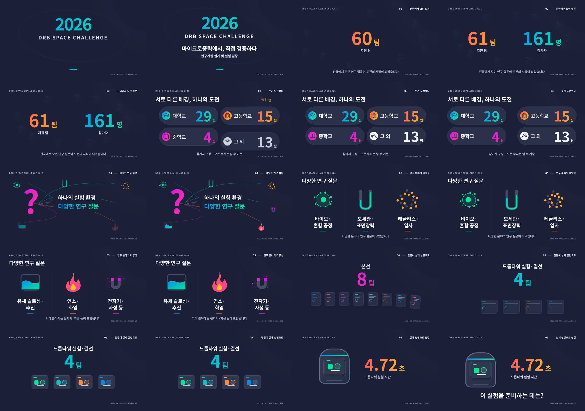

# 2026 DRB Space Challenge 모션 인포그래픽

## 완성 영상 다운로드

- [최종 MP4 다운로드 (4.2MB)](https://github.com/bbbnwd/infographic_motion/blob/main/deliverables/SpaceChallenge2026Infographic.mp4?raw=true)
- [오프라인 재생용 HTML 다운로드](https://github.com/bbbnwd/infographic_motion/blob/main/deliverables/SpaceChallenge2026Preview.html?raw=true) — 내려받아 브라우저에서 열면 재생 및 MP4 저장이 가능합니다.
- [최종 MP4 파일 위치](deliverables/SpaceChallenge2026Infographic.mp4)



독립 Remotion Composition: `SpaceChallenge2026Infographic`.
1920×1080, 30fps, 1200프레임(40초), 무음.

## 실행

Node.js 24에서 검증했습니다. Chromium과 FFmpeg가 설치된 Linux 환경입니다.

```sh
npm ci
npm run studio
```

Remotion Studio에서 `SpaceChallenge2026Infographic`을 선택해 재생하거나 타임라인을 이동합니다.

```sh
npm run typecheck
npm run render
npm run still -- out/frame.png --frame=390 --browser-executable=/usr/bin/chromium
```

최종 영상: `out/SpaceChallenge2026Infographic.mp4`.
다른 운영체제에서는 render 명령의 `--browser-executable`을 해당 Chromium 경로로 바꾸거나 제거하여 Remotion 브라우저를 사용합니다.

## 구성

- `src/data.ts`: 문구, 수치, 팔레트, 장면 시간.
- `src/video.tsx`: 프레임 기반 장면, SVG 연구 분야 상징, 전환.
- `src/visual.css`: 인포그래픽 그래픽 스타일.
- `src/root.tsx`: 독립 Composition 등록.
- `public/fonts/NotoSansCJK-Bold.ttc`: 로컬 한국어 글꼴. 외부 글꼴 서비스에 의존하지 않습니다.

| 시간    | 내용                                                  |
| ------- | ----------------------------------------------------- |
| 0–4초   | 올해의 도전                                           |
| 4–10초  | 61팀 / 161명                                          |
| 10–16초 | 대학교 29팀 / 고등학교 15팀 / 중학교 4팀 / 그 외 13팀 |
| 16–20초 | 하나의 실험 환경, 다양한 연구 질문                    |
| 20–24초 | 바이오·혼합 공정 / 모세관·표면장력 / 레골리스·입자    |
| 24–28초 | 유체 슬로싱·추진 / 연소·화염 / 전자기·자성 등         |
| 28–35초 | 본선 8팀 → 드롭타워 실험·결선 4팀                     |
| 35–40초 | 개별 플레이트 → 단일 캡슐 / 4.72초 / 마지막 질문      |

참가자 수치는 팀 수이며, 분야 그래픽은 연구 질문을 소개하는 상징입니다. 분야별 수치·비율·실험 결과를 나타내지 않습니다. 기존 체크아웃이 비어 있어 기존 웹툰 Composition은 없었으며, 새 Composition만 등록했습니다. 이미지 첨부가 제공되지 않아 요청의 색상 코드와 그래픽 설명을 기준으로 제작했습니다.

## 글꼴 라이선스

Noto Sans CJK는 SIL Open Font License 1.1로 배포됩니다. `public/fonts/OFL.txt`를 참조하세요.
